# Xinxin

**一个住在你自己电脑里的私人 Agent。** 对话、任务、文件、记忆、技能、绘图、音乐和自动化，全部收在一台机器上，用手机随时操作。

不需要云端部署账号或域名。原文件和运行记录保存在本机；调用外部模型时，所需上下文会发送到你配置的模型服务。

<p align="center">
  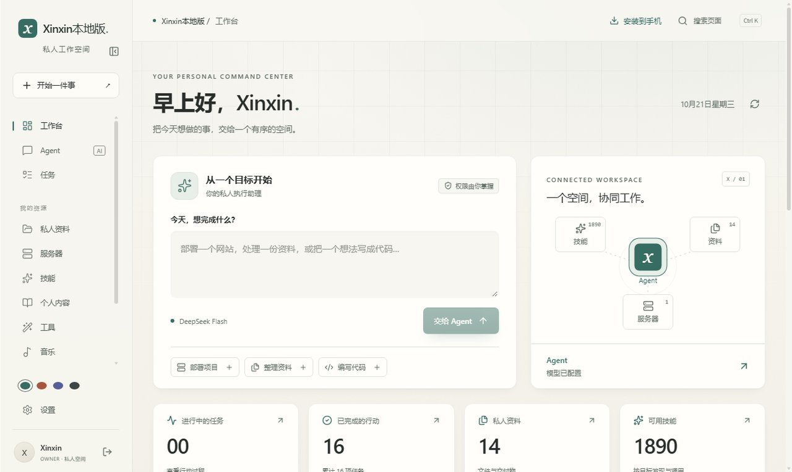
</p>

---

## 它是什么

Xinxin 是一个**单主人、本地优先**的 Agent 工作空间。它把「聊天」和「真正把事做完」放在同一条链路上：

- 你说目标，它拆解、调用工具、读写文件、跑命令，最后把产物交回来
- 每一轮任务都有事件流，断线可回放，超预算会停下并保留现场
- 技能不是一张固定的工具表，而是从 1800+ 个技能里按任务检索、扩展、重排后选出最必要的那几个
- 所有数据、模型密钥、生成文件都留在本机；后端只监听回环，局域网只开一个端口
- 可以用电脑软件端（双击图标）、桌面浏览器、手机浏览器、PWA 或 APK——同一份数据、同一套服务

它最初为云服务器而写，现在以**本机版**分发：开箱即用，手机连同一个 Wi-Fi 就能用。

---

## 技术栈

| 层 | 选型 |
| --- | --- |
| 后端 | FastAPI + SQLite（WAL）+ 自研任务引擎（持久化队列 / 事件流 / 预算 / 续接） |
| 技能检索 | BM25 Okapi + E5 稠密语义（int8 ONNX，384 维）+ 结构/标签三通道融合 |
| 策略学习 | Shared LinUCB（证据门控：工具执行成功才更新） |
| 模型接入 | 任意 OpenAI 兼容 Chat Completions（默认 DeepSeek），流式解析 |
| 前端 | React 19 + TypeScript + Vite 7，14 条路由 / 20 个页面组件，无状态管理库 |
| 可视化 | 自研 Canvas 渲染（技能球 3D 聚类、农历），不依赖 three.js |
| 移动端 | Capacitor 8 打包 APK；PWA（Workbox，prompt 型更新） |
| 网关 | Caddy 单端口反代（`flush_interval -1` 保证 SSE 实时） |
| 桌面端 | PowerShell 5.1 + Edge 应用模式，WindowsJob 进程树终止 |
| 公网（可选） | cloudflared 出站隧道，无需公网 IP |

前后端、桌面启动器和网关编排在同一仓库中维护，业务数据使用 SQLite 单库存储。

> 想读懂实现：[架构与实现](docs/架构与实现.md)（模块地图 / 数据模型 / 接口契约）、
> [算法详解](docs/算法详解.md)（三通道检索的公式与权重、LinUCB、预算与压缩策略）。

---

## 界面导览

### 工作台

一屏看清今天的状态：最近的任务、执行节奏、资料库、可用技能，以及一个可以直接下发任务的入口（见上方首图）。

- 左侧是固定的功能区：Agent、任务、资料、服务器、技能、学习、内容、工具、音乐、记忆、自动化
- 「从一个目标开始」直接把话交给 Agent，不用先想清楚要用哪个工具
- 右侧把「连接的工作区」可视化：技能、Agent、资料、服务器四个节点
- 最近 7 天的执行节奏和待处理任务一眼可见

### Agent

对话只是入口，真正的价值是它能在你的电脑上**持续把事做完**。下面是一轮演示对话：输入一句话，Agent 执行并流式回复；右侧可以展开本轮的过程、产物和技能轨迹。

<p align="center">
  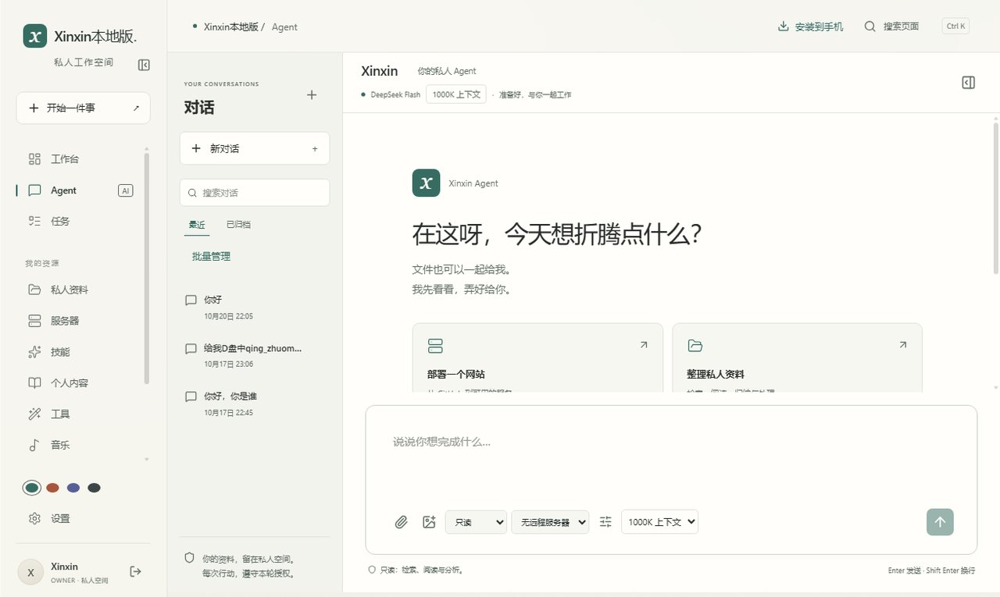
</p>

- 支持附件、图片、代码块和 Markdown 渲染
- 进度说明与最终答复分开记录：断流时的草稿只算过程，不污染历史
- 右侧「任务上下文」按过程 / 产物 / 技能分组，能点开看每一步
- 每轮对话内展示 **SkillNet 能力路线**：匹配了哪些方法、选择理由、实际参考读取和关联工具返回；可点开方法正文、进入本轮结果与交付，历史对话也能恢复
- 简单问答允许不选额外技能；复杂任务按需要说明方法如何帮助当前步骤，避免为展示而加载无关能力
- 可以随时停止；停止后已执行的工具记录仍然保留，支持「继续原任务」续接

SkillNet 把技能库接到实际任务中：目标 → 必要性选择 → 按需阅读方法 → 工具执行 → 答复与交付。路线卡明确区分「匹配」「读取参考」「关联工具成功返回」；模型给出的理由标为建议，最终成果仍以实际文件和验证结果判断。候选分数不会变成执行成功，也不改变本轮权限。

<p align="center">
  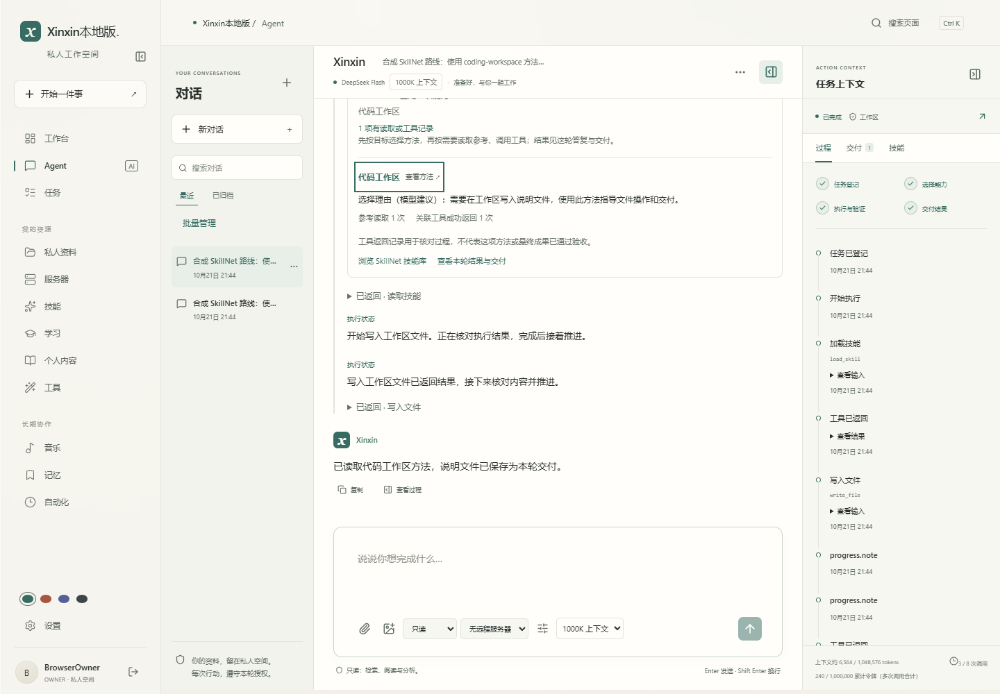
</p>

上图来自隔离合成测试：使用真实界面、检索、执行器与文件交付，模型选择和回复由固定脚本驱动。

### 任务与交付

任务不是一次性的请求，而是可追踪、可回放、可续接的执行单元。

<p align="center">
  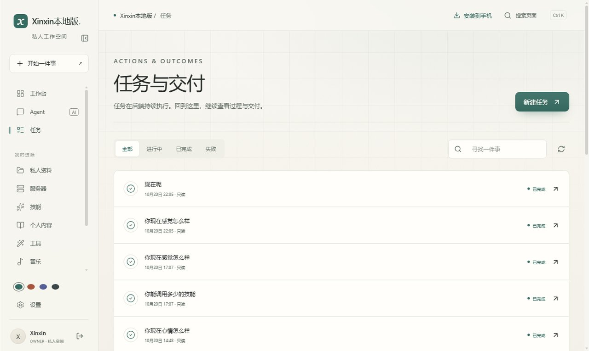
</p>

- 状态：排队、进行中、已完成、失败、已取消
- 每个任务保留事件流（`started` / `skills` / `tool.started` / `tool.completed` / `delta` / `finished`）
- 失败会写清原因（例如预算耗尽），不会被假装成「完成」
- 支持按状态筛选、按关键词搜索、查看单次任务的完整过程

### 私人资料

手机上传，Agent 直接读写；文件永远留在你的电脑上。

<p align="center">
  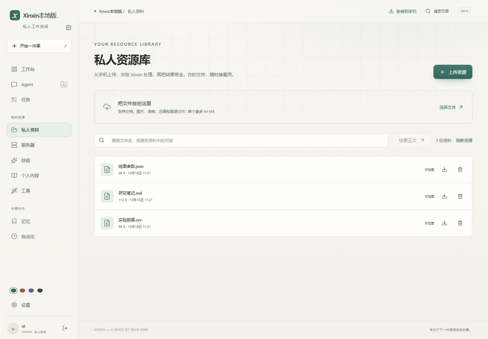
</p>

- 单文件上限 64 MB，上传前先认证，超大请求在解析表单之前就被拒绝
- 同名重试用 `X-Upload-ID` 做幂等：网络抖动不会留下两份文件
- 文本、Markdown、CSV、PDF、DOCX 等自动抽取正文，可被 Agent 检索
- 下载走认证接口，不暴露真实路径

### 服务器

把云端或工作室的机器登记进私人空间，让 Agent 在你授权的权限内操作它。

<p align="center">
  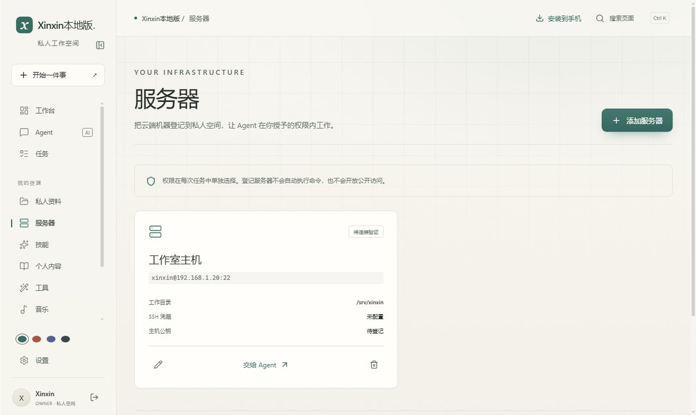
</p>

- 登记 SSH 主机、端口、账号与工作目录，私钥只保存在本机的加密存储里
- 每次任务单独选择目标服务器与权限档位，登记本身不执行任何命令
- 连接状态、主机公钥指纹一目了然，支持「交给 Agent」直接下发远程任务
- 远程执行同样走事件流与预算控制，断线可回放

### 技能中心

这是 Xinxin 和「一堆固定工具」的 Agent 最大的不同。

<p align="center">
  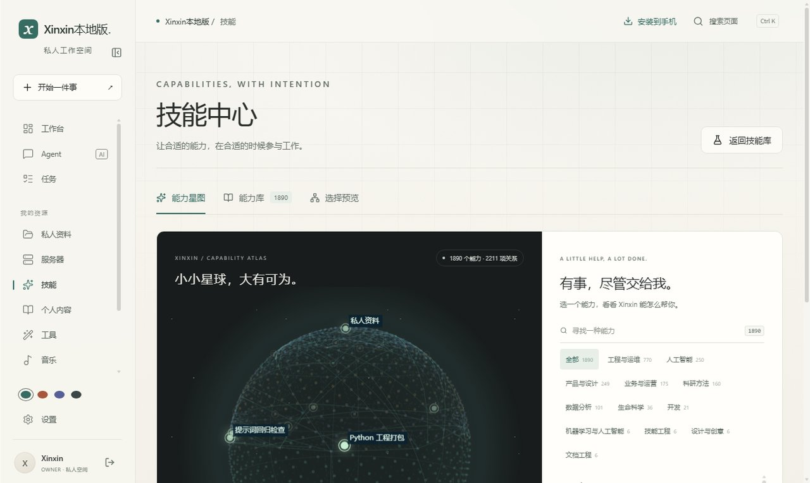
</p>

- 内置 1800+ 个技能，带契约（能力、输入、输出、适用场景）、质量评级和依赖关系
- 技能球按领域聚类，可拖拽、缩放、搜索、按领域筛选
- 每个技能都能看到来源、许可证、依赖和「平台是否真的能执行它」
- 社区技能按**只读资料**处理：正文懒加载、哈希校验，绝不自动执行其中的脚本

### 学习

从读懂一段原文开始，到有依据的出题、练习与复盘。学习首页采用书页索引式排版，出题工作室把目录、原文和定制设置放在同一个工作区；手机上按面板切换。

<p align="center">
  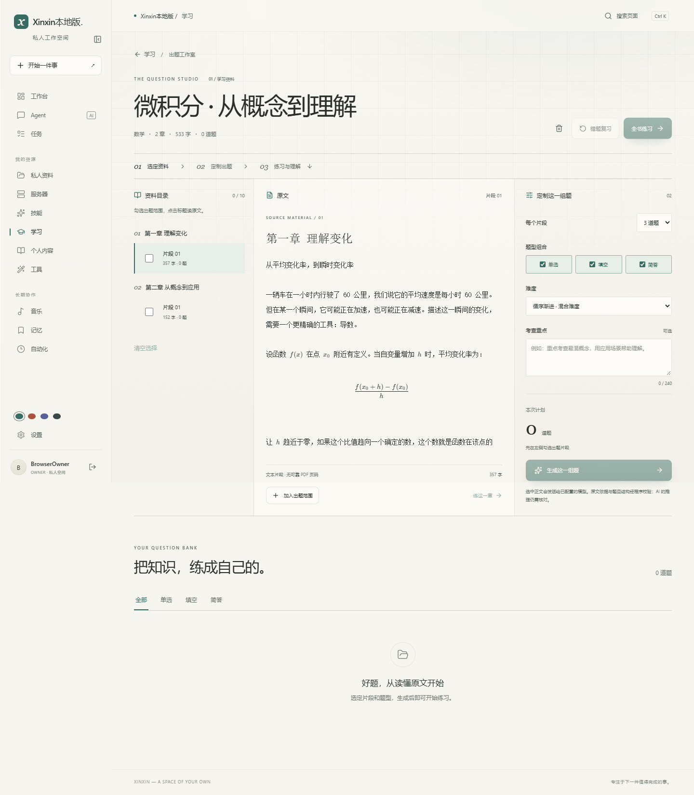
</p>

- 在学习区直接上传或选择已有 PDF / Word / 文本，按标题切章，长章节完整分段；原文件保存在本机，出题与辅导将相关文本发送到你配置的模型服务
- 自选最多 10 个来源片段、每片段 1–6 题，组合单选 / 填空 / 简答、指定难度与考查重点；相邻片段帮助理解上下文
- 每道新题附可核对的原文摘录，校验题型、答案结构、选项唯一性、空位数与难度；过滤重复和无效题，最多两次调用 / 片段，数量不足如实显示
- 出题复用持久化任务引擎和有序事件流，离页或刷新可恢复；可以取消、补出缺少的数量，已入库的题不丢失
- PDF 页码只有在原件逐页提取、精确匹配正文后显示，表示文件中的实际页序；文本、Word 或无法核实的旧资料使用片段标识，不编造页码。题目列表与练习都能回到原文
- 全书 / 本章练习优先未做题并补足数量，错题复习依据每道题的最新作答，做对后移出；首页区分不同题目的已练数量与作答次数
- 判分分开做：选择题、填空题本地比对；简答题交给模型判「意思对不对」，答对一半算部分正确
- 答错或想不通点「让老师讲这道」，老师讲切入点和易错步骤，可以继续追问
- 辅导可切换「普通老师 / Xinxin 辅导」：普通老师专注讲解，Xinxin 保留性格和音乐氛围，陪你一步步想；两种模式按题分别保存对话，切换或刷新可恢复
- 练完后可以回看任意题目、继续追问错题；「再来一组」保留原书本与章节范围
- 练习页是**整页定高**的左右分栏（对齐成熟刷题产品的布局）：左边题目、判分与题号导航，
  右边固定是「画布 + 老师」——老师的讲解在里面滚动，输入框钉在底部，边讲边画
- 画布会接住讲解里出现的函数图（`y = …` 直接出图），也能自己写表达式现场验证；
  离开页面再回来，这道题的讲解还在（历史存库）

<p align="center">
  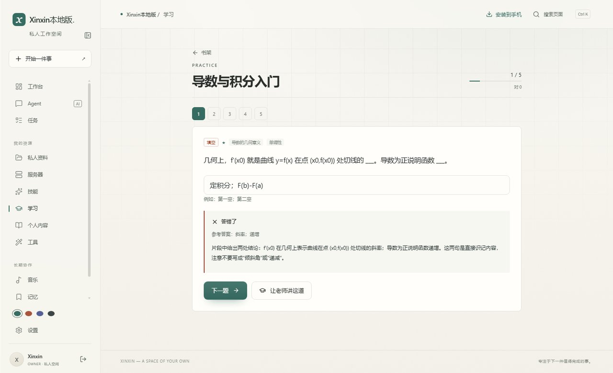
</p>

- 练习会话有进度与正确率，结束后列出值得再看一遍的题
- 首页有函数画布：写 `y = sin(x)` 这样的表达式直接出图，支持四条曲线与悬停读数

出题设计参考了 [zhixu-backend 的来源页码与进度需求](https://github.com/pfx43/zhixu-backend/issues/17)，以及 [章到页目录需求](https://github.com/pfx43/zhixu-backend/issues/16)；本项目独立实现，沿用自己的鉴权、任务和本地数据架构。截图与自动化验收使用合成资料及模型桩，不代表真实模型的教学质量；引文校验也不能保证推理绝对正确。扫描版 PDF 请先做 OCR。旧版曾被截断的章节需重新加入原资料才能恢复已丢失正文。

想学习出题链路：[数据模型、接口与设计取舍](docs/learning-studio.md) · [本轮审查与验证](docs/learning-studio-review.md)。

### 创作工具

数据图、图像处理、拾景，都是可以直接交给 Agent 的工具，也可以单独使用。

<p align="center">
  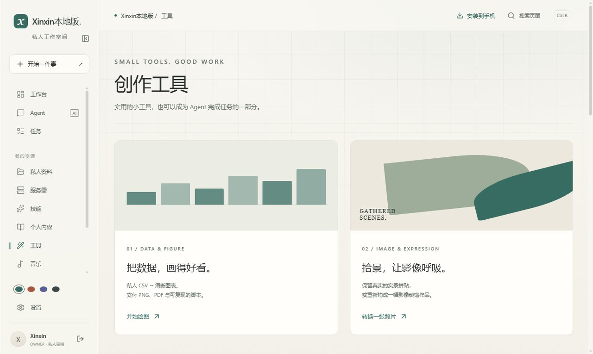
</p>

- 内置 20+ 种论文级图表模板：森林图、火山图、生存曲线、ROC、SHAP、UMAP 等
- 支持 CSV 直接出图，也支持把绘图需求交给 Agent 生成可复现脚本
- 图像处理包括去水印、增强、修复、人像美化、抠图

### 背景音乐

放一首，房间的氛围会跟着变。

<p align="center">
  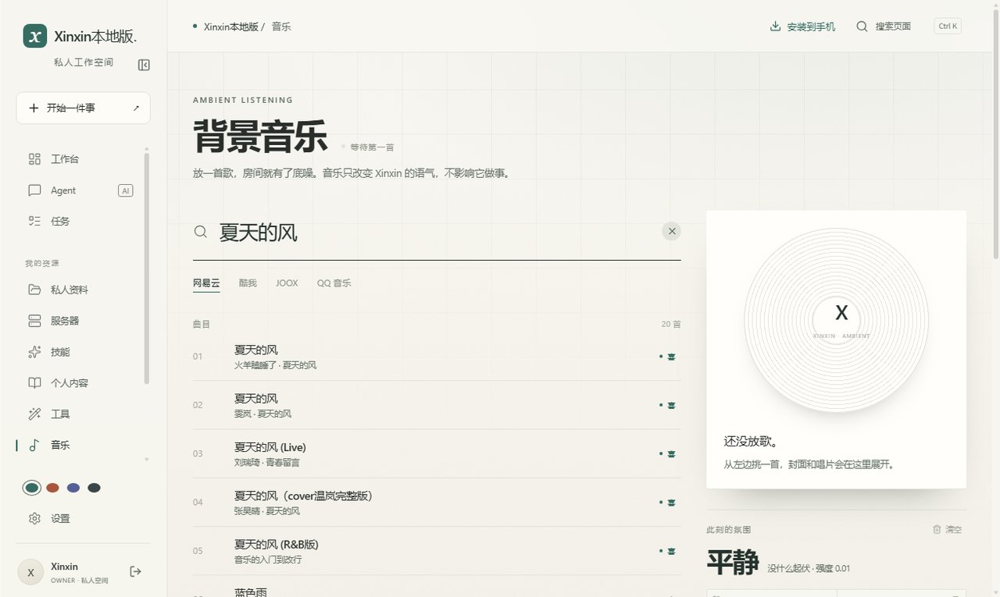
</p>

- 接 GD 音乐台：后端只代理 JSON（搜索 / 取链 / 歌词 / 封面），音频由浏览器直连 CDN，不经过本机
- GD 挂掉时自动切到网易云直连（搜索 / 试听 / 歌词 / 封面四件套）；直连拿不到会员曲，
  列表里会标「会员」，换免费的就能放；其余音源会明确提示等它恢复
- 每首歌由模型结合歌名、歌手与专辑校准情绪：四象限（喜 / 怒 / 哀 / 乐）之外，再给 1～3 个
  具体情绪词（温柔 / 浪漫 / 治愈 / 怀旧 / 孤独 / 热血 / 压抑 / 空灵…共 16 个），结果按歌曲缓存
- 收藏与歌单：点歌名右边的心收藏，点「+」放进歌单；歌单可以整个播放，放完自动下一首
- 歌词面板是独立的宽窗口：滚动歌词，当前句高亮跟随进度自动滚到视线中间；有译文时
  中文原文下面跟一行译文；播放中随时点专辑封面上的心把这首歌收进收藏
- 最近播放按 90 分钟半衰期聚合成「此刻的氛围」，并给出占比最高的情绪词；可一键关闭或清空
- 每首歌有自己的情绪强度；Xinxin 的「感受指数」另有克制 / 自然 / 敏感 / 共鸣四档（0.4× / 1× / 1.5× / 2.2×），默认自然。同一首歌不会因档位改变评分，改变的是 Xinxin 对音乐的敏感度
- 界面分别显示音乐情绪强度和 Xinxin 实际感受；实际感受结合近期听歌的时间衰减与感受指数，供 Agent 和 Xinxin 辅导调整表达。关闭后不注入音乐氛围，重新开启保留档位
- 歌曲悬停轻微右移，播放进度、情绪校准与收藏刷新时保持稳定；播放失败不会计入情绪，暂停后恢复不重复记录
- 播放器是全局的：切到别的页面继续放，右下角留着播控条

### 个人内容

文章、相册、诗词、简历，都放在自己的私人空间里。
<p align="center">
  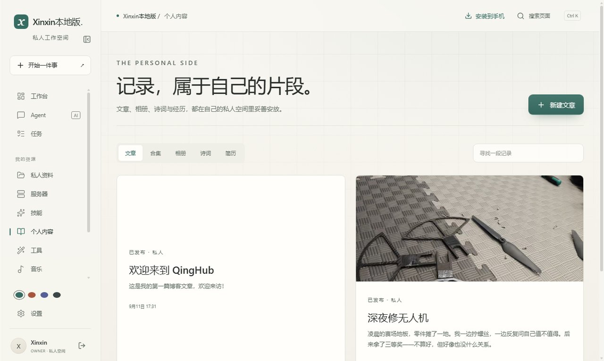
</p>

- 五种内容形态，各自有适合的展示方式
- 草稿与已发布分开，默认全部私有
- 可以附图、附件，Agent 也能读取这些内容作为上下文

### 记忆

少解释几遍，多一点长期理解。

<p align="center">
  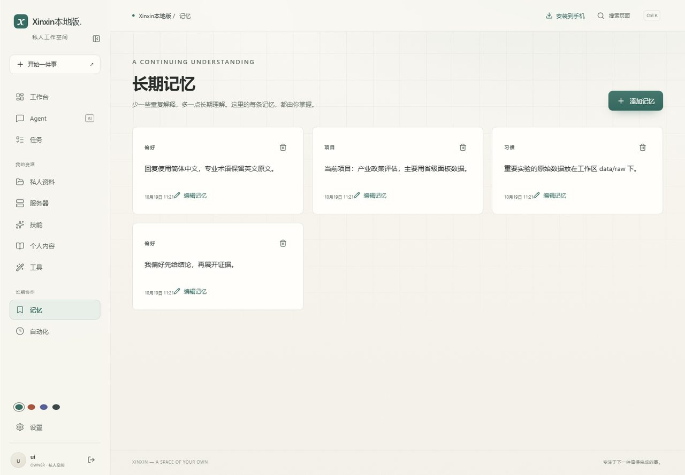
</p>

- 偏好、事实、项目、习惯四类记忆
- 可以在设置里手动维护，也可以在对话中让 Agent 记住
- 记忆不进入云端；每轮只注入最近的少量条目，避免挤占上下文

### 自动化

把重复的事交给定时任务。

<p align="center">
  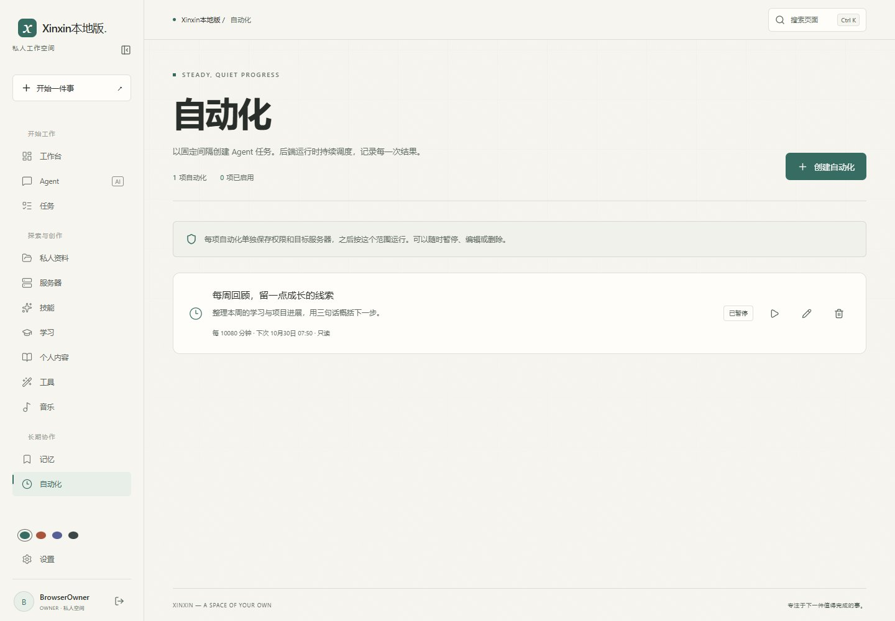
</p>

- 固定间隔执行，权限和目标服务器随任务保存
- 停机期间不补跑，避免堆积副作用
- 每次执行都产生独立的任务记录，可回放、可停止

### 设置

模型、密钥、邮箱、背景、连接地址，都在一个地方。

<p align="center">
  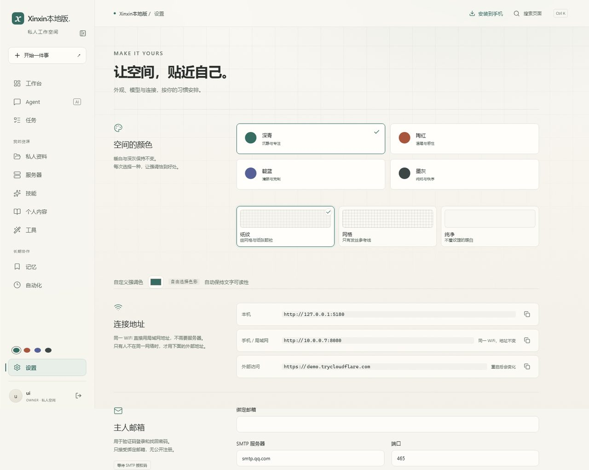
</p>

- 模型走任意 OpenAI 兼容接口，默认 DeepSeek；密钥加密存储，不回显
- 邮箱验证码（可选）：SMTP 或 Resend 自定义域名，配好可用「发送测试邮件」验证
- 三档背景（纸纹 / 网格 / 纯净）和四种强调色，跟随你的习惯
- 「连接地址」直接显示本机、局域网和当前外部地址，可一键复制——不用记 IP

### 手机端

手机是控制端，不是执行端：命令始终在电脑上跑，手机只负责下发和查看。

<p align="center">
  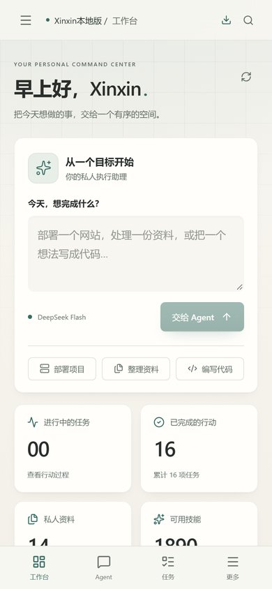
</p>

- 响应式布局，手机浏览器可用，也可以「添加到主屏幕」当 PWA
- 支持打包 APK，预填局域网地址
- 抽屉式导航、触控友好的任务卡片、移动端输入框

---

## 它能做什么

下面按使用场景介绍功能；本次实际测试范围和外部依赖见「验证与边界」。

### 对话与执行

| 能力 | 说明 |
| --- | --- |
| 多轮对话 | 支持 Markdown 渲染、代码块高亮、图片与附件；流式回复逐字出现 |
| 任务拆解 | 一句话目标会被拆成可执行步骤，由 Agent 自己调工具完成，不需要你指定用哪个工具 |
| 工具调用 | 文件读写、命令执行、网络请求、绘图、图片处理等，全部在本机执行 |
| 进度说明 | 执行过程中的中间说明与最终答复分开记录，断流草稿不污染历史 |
| 手动停止 | 任务跑到一半可以随时停；已执行的工具记录保留，支持续接 |
| 幂等重试 | 同一个 `request_key` 重复提交不会重复执行 |

### 研究与资料

| 能力 | 说明 |
| --- | --- |
| 文件上传 | 单文件 64 MB 上限，认证后解析，超大请求在解 multipart 之前就被拒绝 |
| 幂等上传 | 同名重试带 `X-Upload-ID`，网络抖动不会留下两份 |
| 正文抽取 | 文本、Markdown、CSV、PDF、DOCX 等自动抽取正文供检索 |
| 全文检索 | 上传的资料可被 Agent 检索并在回答中引用 |
| 论文级绘图 | 20+ 种图表模板（森林图、火山图、生存曲线、ROC、SHAP、UMAP 等） |
| 图片处理 | 去水印、增强、修复、人像美化、抠图 |

### 服务器与目标机

| 能力 | 说明 |
| --- | --- |
| 目标机登记 | SSH 主机 / 端口 / 账号 / 工作目录；私钥加密存储，不回显 |
| 权限随任务 | 每次执行单独选择服务器与权限档位，不共享全局凭证 |
| 远程执行 | 在目标机上跑命令、读写文件，事件流与预算控制与本地一致 |
| 连接校验 | 主机公钥指纹展示，新增主机需要显式确认 |

### 内容生产

| 形态 | 说明 |
| --- | --- |
| 文章 / 合集 | 长文写作与多篇组合，支持草稿与发布状态 |
| 相册 | 图片集合管理 |
| 诗词 | 诗、词、赋等短篇内容 |
| 简历 | 结构化个人简历 |
| 共同能力 | 草稿与已发布分开，默认全部私有；可附图附件，Agent 也能读取这些内容作为上下文 |

### 学习与出题

| 能力 | 说明 |
| --- | --- |
| 书本上架 | 在学习区上传或选择 PDF / Word / 文本，按标题分章与完整分段，原资料保存在本机 |
| 定制出题 | 最多 10 个片段、每段 1–6 题，题型组合、难度、重点可选；正文送往配置的模型 |
| 来源与质量 | 原文摘录核验、可靠 PDF 页序、答案与选项校验、重复过滤；不承诺模型语义绝对正确 |
| 出题任务 | runs / SSE 持久化进度、调用与令牌预算、取消、刷新恢复、显式补出未完成数量 |
| 错题复习 | 按每题最新作答选择错题，答对后不再归入错题；同书同章范围校验 |
| 本地判分 | 选择题比对字母，填空题逐空比对（忽略空格与标点），不把答案交给模型 |
| 主观题判分 | 简答题交模型判「意思对不对」，返回 correct / partial / wrong 与扣分点 |
| AI 讲题 | 讲知识点与切入步骤，可连续追问；回答里可以带函数图 |
| 函数画布 | 自己写表达式出图，支持隐式乘法、三角函数、指数对数与最多四条曲线 |
| 学习统计 | 正确率、薄弱知识点标签、最近练习记录 |
| 不泄题 | 未作答的题，接口不返回答案与解析；答过才可见 |
| 判分留痕 | 每次作答记录状态、判分方式与理由，可回看 |
| 讲解留存 | 讲题对话按题存库，换题或重进页面自动回填 |

### 背景音乐与情绪

| 能力 | 说明 |
| --- | --- |
| 音乐检索 | 四个音源（网易云 / 酷我 / JOOX / QQ 音乐），服务端只代理 JSON |
| 音频播放 | 浏览器直连平台 CDN；后端不下载、不转存、不转发音频流 |
| 情绪指数 | 每首歌给出愉悦度与能量，归到喜 / 怒 / 哀 / 乐四类，附一句判断理由；模型不可用时退回本地词表 |
| 氛围聚合 | 最近播放按 90 分钟半衰期加权，得到当前强度与坐标 |
| 人格联动 | 氛围写进系统提示，只影响语气；关掉开关即完全不注入 |
| 全局播放器 | 切页不断播，桌面右下 / 手机底部保留播控条与小进度 |
| 收藏 | 一首歌一键收进收藏，列表同样带情绪词 |
| 歌单 | 自建歌单、加歌/移歌、整单连播（放完自动下一首） |

### 长期协作

| 能力 | 说明 |
| --- | --- |
| 记忆 | 偏好、事实、项目、习惯四类；可手动维护或让 Agent 记住；每轮只注入最近少量条目 |
| 定时任务 | 固定间隔执行，停机期间不补跑；每次执行产生独立任务记录 |
| 任务续接 | 断线回放、失败后接着跑、预算耗尽后保留现场 |
| 断点续传 | SSE 断线带上 `Last-Event-ID` 可从游标续传 |

### 技能体系

| 能力 | 说明 |
| --- | --- |
| 1800+ 内置技能 | 带契约（能力、输入、输出、适用场景）、质量评级、依赖关系 |
| 三通道融合 | BM25 + E5 稠密 + 结构/标签召回，加权融合 |
| 关系扩展 | 按 `compose_with` / `depend_on` 图扩展候选 |
| 必要性重排 | LLM 判断哪些技能真的需要，可以少选、可以不选 |
| 对话能力路线 | 展示匹配理由、参考读取、关联工具返回和本轮交付入口；历史记录从原事件恢复 |
| 置信度分流 | 自动 / 确认 / 直答三档，按检索分数分流 |
| 证据门控学习 | 有工具执行成功证据才更新 LinUCB；没有证据不学习 |
| 只读语料 | 社区技能按只读资料处理，绝不自动执行其中脚本 |

### 多端

| 端 | 形态 |
| --- | --- |
| 电脑软件端 | 桌面图标一键启动，独立应用窗口（无地址栏/标签页） |
| 桌面浏览器 | 直接打开本机或局域网地址 |
| 手机浏览器 | 响应式布局，可「添加到主屏幕」当 PWA |
| Android APK | 自签打包，预填局域网地址 |

### 模型与安全

| 能力 | 说明 |
| --- | --- |
| 任意 OpenAI 兼容接口 | 走 Chat Completions；默认 DeepSeek，可换任意兼容服务 |
| 密钥本地加密 | `vault.key` 加密存储，不回传前端、不进日志 |
| 单主人认证 | 一个账号，CORS 精确来源白名单 |
| 邮箱验证码（可选） | SMTP 或 Resend 自定义域名；凭据加密保存，接口不回显 |
| 数据不出机器 | 后端默认只监听 `127.0.0.1`，局域网唯一入口是 Caddy 网关 |
| 社区技能只读 | 正文按需加载并做 SHA-256 校验 |

---

## 和市面上的 Agent 有什么不同

### 一句话概括

> 市面上的 Agent 多是「把工具清单塞给模型」；Xinxin 是「先检索出候选技能，再让模型判断必要性，最后只把需要的交给它」——而且所有证据、预算和执行记录都留在本地。

### 功能差异

| 维度 | 常见云端 Agent | Xinxin |
| --- | --- | --- |
| 数据位置 | 平台账号与租户空间 | 本机 SQLite + 本地文件，默认不出机器 |
| 模型密钥 | 平台托管 | 本地加密（`vault.key`），不回传前端 |
| 工具来源 | 固定插件 / 应用市场安装代码 | 1800+ 只读技能语料；只有注册了工具的技能才能真正执行 |
| 技能选择 | 全量工具塞进提示，或向量 Top-K | 三通道融合 → 质量先验 → 关系扩展 → LLM 必要性重排 → 置信度分流 |
| 可以「不选」 | 通常强行调用一个工具 | 允许明确弃权（返回空选择），交给通用模型直答 |
| 学习机制 | 无，或简单的点击反馈 | 有工具成功证据才更新共享 LinUCB；没有证据不学习 |
| 任务模型 | 一次请求一次响应 | 持久化任务队列 + 事件流 + 断点续接 + 预算控制 |
| 失败处理 | 重试或直接报错 | 记录失败原因，保留已执行证据，可续接 |
| 网络形态 | SaaS，必须有公网入口 | 局域网优先，只开一个端口；外部访问是可选叠加 |
| 手机形态 | 官方 App | 手机浏览器 / PWA / 自签 APK，地址可预填 |
| 目标机 | 基本不支持，或要另配一套部署 | 登记 SSH 主机，权限随任务，远程执行与本地同一条事件流 |
| 氛围音乐 | 无 | 背景音乐 + 情绪指数（模型校准），只影响语气、不影响判断 |

### 机制差异（重点）

#### 1. 技能路由：不是「工具列表」，是「检索 + 判断」

```
任务
 ├─ BM25 词汇召回
 ├─ E5 稠密语义召回
 └─ 领域 / 标签结构召回
        ↓ 加权融合（稠密 0.35 / 0.55 / 0.10）
   质量先验 0.85 + 0.3 × quality
        ↓
   关系图扩展（compose_with 0.88 / depend_on 0.80）
        ↓
   LLM 任务必要性重排（可少选、可不选，给出理由）
        ↓
   置信度分流：BM25 原始分 ≥15 自动 / ≥2 确认 / <2 直答
        ↓
   依赖拓扑排序 → 只把必要的技能卡交给 Agent
```

大多数 Agent 把所有工具定义塞进系统提示，技能一多就上下文爆炸；或者只做向量 Top-K，容易把「同领域但没用」的技能带进来。Xinxin 把「缩小空间」和「判断必要性」拆成两步，并且允许模型**明确说不**。

#### 2. 学习：没有执行证据，就不更新策略

技能被选中不等于它有用。只有同时满足：

- 本轮 `skills` 事件里确实选中了它
- 对应的工具真的执行成功（`tool.completed.ok = true`）

才允许提交反馈，更新共享 LinUCB。这样避免「模型说它好 → 它被排得更前 → 更常被选中」的自我强化。

#### 3. 执行：任务是有状态的，不是一次 HTTP 请求

```
queued → running → completed / failed / cancelled
events: queued · started · skills · usage · tool.* · delta · progress · finished
```

- 事件落 SQLite，SSE 推送；断线带上 `Last-Event-ID` 可以从游标续传
- 预算同时限制调用次数和令牌；耗尽时停止并保留现场，不清空已做的工具结果
- 同一 `request_key` 幂等，重复提交不会重复执行
- 单进程单 worker，避免多进程争抢同一份 SQLite

#### 4. 安全边界：把「能访问」和「能执行」分开

- 后端和前端只绑 `127.0.0.1`，局域网唯一入口是 Caddy 的 `8080`
- 认证是单主人账号；CORS 是精确来源白名单，不是 `*`
- 上传在解析 multipart 之前就校验身份和长度；落盘用 staging + 原子提交
- 社区技能语料只读，正文按需加载并做 SHA-256 校验，不 import 其中的 Python
- 密钥、密码、令牌不进入回答、产物和日志

---

## 内在逻辑

### 架构

```
┌────────────────────────── 这台电脑 ──────────────────────────┐
│                                                              │
│   浏览器 / PWA / APK                                          │
│          │ HTTP（局域网）                                     │
│          ▼                                                   │
│   Caddy 网关 :8080  ──反代──┐                                 │
│                             ├──> frontend 127.0.0.1:5180     │
│                             │     静态站点 + /api 代理        │
│                             └──> backend  127.0.0.1:8010     │
│                                   FastAPI + SQLite(WAL)      │
│                                   TaskManager / ModelGateway │
│                                   SkillRouter / 工具执行器     │
│                                                              │
│   backend/data/  ← 账号、密钥、文件、记忆、任务、事件          │
│   backend/resources/skillnet/  ← 只读技能语料                 │
└──────────────────────────────────────────────────────────────┘
```

- 只有一个对外端口；没有公网 IP 也能在局域网完整使用
- 数据层是 SQLite（WAL），任务、事件、会话、记忆同库事务
- 模型层是 OpenAI 兼容的 `Chat Completions`，可以换任意兼容服务

### 一轮任务的完整链路

```
1. 浏览器 POST /runs              → 持久化任务，返回 run_id
2. TaskManager 取队              → started 事件
3. SkillRouter.search            → 召回 / 扩展 / 重排 / 置信度
4. build_system_prompt           → 只注入选中的技能卡和工具证据
5. ModelGateway.apredict         → 流式输出；工具调用进入执行器
6. 工具执行                      → tool.started / tool.completed（含证据）
7. 事件写入 SQLite + SSE 推送     → 手机/浏览器实时看到进度
8. finished                      → 结果、用量、错误一起落库
```

### 提示空间怎么被控制

- 候选技能超过预算时，先压缩技能卡为 `selected_ids`，**再**裁剪前轮工具证据
- 检索审计数据（`candidates` / `graph_added`）只用于展示，不进入系统提示
- 上一轮的工具证据带 `seq`、参数和结果摘要，续接任务不靠模型记忆

> 每一步的公式、权重与取舍（为什么用 BM25 原始分做置信度标尺、为什么压缩顺序如此、
> LinUCB 为什么要求执行证据）都写在 [算法详解](docs/算法详解.md)。

---

## 快速开始

前置：Python 3.12+、Node.js 20+、Git；手机访问还需要 Caddy（`winget install Caddy.Caddy`，或放到 `tools/caddy.exe`）。

### 从 GitHub 获取

```powershell
# 1. 克隆到本地（或用你自己的 fork / 镜像地址）
git clone https://github.com/qing1989620/xinxin-local.git
cd xinxin-local

# 2. 一次启动（脚本会自动：建 venv → 装 Python 依赖 → npm install → npm run build）
./Start-Xinxin-Local.ps1
```

**第一次运行会做什么**（全部自动，不用手动干预）：

1. `backend/.venv/` 建 Python 虚拟环境，按 `backend/requirements.lock` 装依赖
2. `frontend/` 跑 `npm install`（按 `package-lock.json`）和 `npm run build` 生成 `dist/`
3. 启动三个角色：`backend` (FastAPI + SQLite)、`frontend` (Vite 预览)、`gateway` (Caddy 网关)
4. 自动放行 Windows 防火墙（程序规则），终端打印本机 / 局域网地址

> **提示**：依赖锁文件 `requirements.lock` 和 `package-lock.json` 都在仓库里，
> 克隆后不需要手动装任何依赖，也不需要手动构建——脚本会判断产物是否过期并自动重建。

### 验证安装成功

终端看到下面这段就是成功了：

```
Xinxin本地版 已启动
  本机浏览器:    http://127.0.0.1:5180
  手机/局域网:   http://10.0.0.x:8080   （同一 WiFi，无需服务器）
  停止: ./Stop-Xinxin-Local.ps1
  防火墙：已放行网关（程序规则），手机与电脑在同一 WiFi 即可访问
```

浏览器打开 `http://127.0.0.1:5180`，首次访问会让你创建主人账号（只需一次）。模型密钥在
「设置 → 对话模型」里填，保存后即可使用。

**健康检查**：浏览器或命令行访问 `http://127.0.0.1:8080/health`，返回
`{"status":"ok","product":"Xinxin","version":"0.1.0"}` 即一切正常。

### 常用命令

| 操作 | 命令 |
| --- | --- |
| 只本机调试（不起网关） | `./Start-Xinxin-Local.ps1 -NoGateway` |
| 不自动开浏览器 | `./Start-Xinxin-Local.ps1 -NoBrowser` |
| 换网关端口 | `./Start-Xinxin-Local.ps1 -GatewayPort 9090` |
| 换后端端口 | `./Start-Xinxin-Local.ps1 -BackendPort 8011` |
| 换前端端口 | `./Start-Xinxin-Local.ps1 -FrontendPort 5181` |
| 停止全部服务 | `./Stop-Xinxin-Local.ps1` |
| 查看服务状态 | `./Start-Xinxin-Local.ps1 -NoBrowser`（已运行会提示 already running） |
| 后端测试 | `cd backend && .venv/Scripts/python -m pytest -q` |
| 前端测试 | `cd frontend && npx vitest run` |
| 桌面/手机浏览器回归 | `cd frontend && npm run test:e2e`（需后端 `.venv`，默认使用已安装的 Edge；其他 Chromium 可设 `PLAYWRIGHT_CHANNEL`） |
| 只跑某个后端测试 | `cd backend && .venv/Scripts/python -m pytest tests/test_script_encoding.py -v` |

### 电脑软件端（可选）

想「像普通软件一样」用——双击图标自动就绪、独立应用窗口、无地址栏：

```powershell
# 装桌面图标和开始菜单项（只创建快捷方式，不复制代码）
./Install-Xinxin-Desktop.ps1
# 或双击
安装电脑端.cmd
```

安装后双击桌面 `Xinxin` 图标即可：服务没起会自动拉起（显示启动页），就绪后打开独立应用窗口。
更新代码后仍可直接双击这个图标：启动器会检查运行中的后端是否属于当前版本，更新受管理的旧服务，再刷新过期的桌面界面；已有任务正在执行时保留服务，待任务结束后再完成更新。
详见 [`docs/电脑端.md`](docs/电脑端.md)。

### 手机

1. 手机与电脑连同一个 Wi-Fi
2. 浏览器打开 `http://<电脑局域网IP>:8080`，或安装预填地址的 APK

```powershell
cd frontend
.\build-android.ps1 -Local -Release -BackendUrl http://<本机局域网IP>:8080
```

APK 生成在 `frontend/releases/Xinxin-0.1.0-local.apk`，使用你自己的签名。

### 常见问题

| 现象 | 处理 |
| --- | --- |
| `Python 3.12+ is required` | 装 Python 3.12+，重新运行 |
| `Port 8080 is occupied` | 换端口：`./Start-Xinxin-Local.ps1 -GatewayPort 9090` |
| 首次运行很慢 | 正常——要建 venv、装依赖、构建前端，几分钟内完成 |
| 改了前端代码但页面没变 | 脚本检测到源码比产物新会自动重建；或手动 `cd frontend && npm run build` |
| 手机打不开 | 确认同一 Wi-Fi；跑一次 `./Setup-Lan-Access.ps1`（需管理员）放行防火墙 |
| 忘了账号密码 | 数据都在 `backend/data/`，详见「数据与备份」 |

---

## 验证与边界

2026-10-21 的音乐与学习优化见 [首轮验证](docs/verification-music-learning-2026-10-21.md)，感受指数重设计、桌面服务更新及 SkillNet 对话路线见 [本次验证记录](docs/verification-sensitivity-skillnet-2026-10-21.md)。浏览器测试自动启动独立合成数据库和模拟模型，不使用主人真实数据；外部音乐 CDN 与真实模型的响应质量仍取决于对应服务。

本次：后端全量 **256** 项、前端 **62** 项、桌面与手机浏览器 **56** 项通过；TypeScript 与生产构建通过。桌面修复后另跑 **4** 项定向回归（含新增的进程归属测试），覆盖配置保护、崩溃恢复、中文 UTF-8 配置与 PID 复用。

2026-10-19 的历史验收范围（本次没有重新验收公网链路或 Android APK）：

- 后端 **172** 项测试、前端 **43** 项测试通过；TypeScript 与生产构建通过
- 14 个页面 + 1 个对话态用无头浏览器逐页检查：**0 控制台错误、0 未捕获异常**
- 公网链路 21 项验收：HTTPS 登录、CORS、上传/下载（中文文件名）、401 CORS、SSE 到结束、断点续传、真实 Agent 任务、Fabric 重排
- 真实浏览器点击流程：登录表单 → Agent 输入 → 模型流式回复，全链路通过
- 电脑软件端 11 项验收通过：单实例、冷启动、端口占用错误窗口、VBS 无窗口、安装/卸载快捷方式、日志编码等（详见 [`docs/电脑端验收.md`](docs/电脑端验收.md)）

明确的边界：

- 单主人、单进程；不是多租户 SaaS
- 本机版默认只在局域网可用；跨网络访问属于可选叠加，不是运行前提
- 社区技能是参考资料，不代表已经在本机验证过
- 模型的质量决定任务质量；平台不承诺「任何任务都能自动完成」

---

## 数据与备份

- 账号、密钥、文件、记忆、任务都在 `backend/data/`
- **`backend/data/vault.key` 不能丢**：丢失后加密凭据不可恢复
- 停服后复制整个 `backend/data/` 即完整备份
- `backend/resources/skillnet/` 随仓库分发，可离线校验

---

## 仓库结构

```
.
├── Start-Xinxin-Local.ps1 / Stop-Xinxin-Local.ps1   # 三角色启停（一键启动/停止）
├── Start-Tunnel.ps1 / Stop-Tunnel.ps1               # 可选：外部访问（Cloudflare 隧道）
├── Setup-Lan-Access.ps1                             # 放行局域网防火墙
├── Caddyfile.local                                  # 单端口网关配置
├── 启动Xinxin本地版.cmd / 启动公网访问.cmd              # 双击启动入口
├── 安装电脑端.cmd / 卸载电脑端.cmd                      # 电脑软件端装/卸
├── desktop/                                         # 电脑软件端
│   ├── Xinxin-Desktop.ps1          # 启动器：自动就绪 + 独立应用窗口 + 单实例
│   ├── Xinxin-Desktop.vbs          # 无窗口入口（快捷方式调用）
│   ├── Install/Uninstall-*.ps1     # 快捷方式装/卸
│   └── assets/                     # 启动页、错误页模板、图标
├── backend/                                         # FastAPI + SQLite
│   ├── app/            # 路由、任务、技能、模型、工具
│   ├── tests/          # 后端自动化与桌面服务集成回归
│   ├── scripts/        # 冒烟、全链路、演示数据
│   └── resources/      # SkillNet 语料（1800+ 技能）、绘图参考
├── frontend/                                        # React + TypeScript
│   ├── src/            # 页面、组件、样式
│   ├── tests/          # 前端单元回归
│   ├── e2e/            # 桌面与手机浏览器交互、真实 HTTP / SQLite 联调
│   └── build-android.ps1           # Android APK 打包
└── docs/               # 架构与实现、算法详解、部署、验收、截图
```

前后端只通过版本化 HTTP 接口和事件契约协作，不跨目录 import，不直连数据库。

### 用 GitHub 协作

仓库目前是单分支 `main`，推送到 `github.com/qing1989620/xinxin-local`。要给它发 PR、或者
从你自己的 fork 派生时，按常规 Git 流程即可：

```powershell
# 克隆到你自己的 fork
git clone https://github.com/<your-name>/xinxin-local.git
cd xinxin-local
git remote add upstream https://github.com/qing1989620/xinxin-local.git

# 同步上游
git fetch upstream
git merge upstream/main

# 开分支改代码，改完推到你的 fork
git checkout -b my-feature
git push -u origin my-feature
```

数据与密钥不进 Git：`backend/data/`、`.runtime/`、`vendor/`、`**/.env` 都在 `.gitignore`
里。推送前 `git status` 确认没有意外的运行时文件。

---

## 许可

本项目代码采用 MIT 许可（见 [LICENSE](LICENSE)）。`backend/resources/` 与 `vendor/` 中的第三方组件保留各自许可，详见 [`backend/THIRD_PARTY.md`](backend/THIRD_PARTY.md)。
