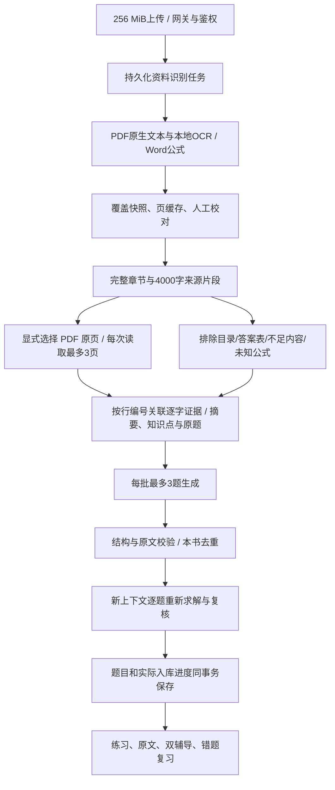

# 学习工作室：资料、知识、题目和证据

实现依据 [学习质量合同](specs/2026-10-22-learning-quality.md) 与 [练习册零题修复](specs/2026-10-23-learning-evidence.md)。前端通过 HTTP / SSE 工作；文件、SQLite、授权与模型调用都在后端。验证与边界见 [全站审计](ui-audit-2026-10-22/review.md) 与 [本次增量审查](ui-audit-2026-10-23/quick-review.md)。



## 识别不是上传成功

上传阶段有界提取原生文本；加入学习后，使用持久化任务逐页 OCR。即使 PDF 页眉已有超过 40 字，也检查大幅图片，包含 Form XObject 和内容流 inline image。PDFium 的所有操作由进程级互斥保护；复制图片后释放渲染锁，再使用单引擎 CPU OCR，运行时不下载模型。

支持最多 1600 页、600 万字、500 个章节分段，超出明确拒绝，不截断。PDF / Word 不再因旧 16 MiB 文本阈值而跳过提取；使用可寻址原件路径，正文/XML另有边界。网关 body 上限 268697600 字节（256 MiB 加 multipart 余量），后端另外验证实际文件大小、身份和两路上传槽位。

`file_ocr_pages` 缓存完成页面，取消/重开可复用。取消会等待工作线程退出，随后不再创建书。`learning_book_extractions` 固定创建时识别覆盖，重识别/删除原件不改变旧书的识别历史。导入快照使用单条 SQL 同时读取 run 状态与书本 ID，避免“完成却没有书”的竞态。

Word 保留常见幂、下标、分式、根式、所有定界表达式与无横线叠式；花括号按 KaTeX 字面符号转义。未知数学结构明确标记“公式待校对”，相关来源暂停出题。OCR 的公式、单位、低清文字和图示仍需人工核对。

出题前可修改学习副本原文并清除旧分析；已有题目的来源禁止覆盖，保证引用不被改成另一段文字。重新识别创建新书副本，保留旧题和作答。多级编号题干不会移出正文。

## 理解范围与质量门槛

`document_text.py` 管本地提取，`learning_imports.py` 管导入，`learning_visual.py` 管用户明确选择的原页读取与缓存，`learning_evidence.py` 将行编号还原为服务器原文，`learning_quality.py` 管分类与接受规则，`learning_studio.py` 管来源和生成，`learning.py` 保留书架、判分和辅导。

来源按章节完整切成至多 4000 字的非重叠片段，优先段落/句子边界。页序必须从真实提取 page spans 与原文精确匹配；不能核实、Word及文本均显示片段，不推测页码。

先排除目录、纯答案、正文不足及未知公式，再要求模型分析分类、摘要、知识点和完整原题。模型通过 `L2-L8` 选择证据，服务器回填原文；长物理行每 400 字拆成连续编号片段，解析与页码映射使用相同切分，拼接保留原字符及换行。不以模糊匹配改动数字、公式和符号。兼容有效旧文字引用。单条引用无效或超出清单上限不再否决其余有效条目；16 个知识点 / 30 个原题的限制按有效条目计算，界面展示跳过数量与原因。零有效证据最多重试一次。分析仍不足时停止出题。完整编号题（包括 `(1)`、`（1）`）最低 24 个非空白字符，普通知识文字仍需 80 字；正常上传和直接建书共用最低长度约束。

公式 OCR 残缺时，可在出题设置显式选择 PDF 原页读取。当前支持 DeepSeek Flash 官方接口；默认不外发图片，预览原页本身只访问本机。最多 3 页一组读取，每片段最多 24 页、每任务最多 60 页。转录是独立识别结果，不覆盖原书或原 OCR，`learning_visual_pages` 按书本、页、协议版本与模型缓存，取消后保留已完成页面。视觉题通过行编号定位实际页序，题目保存 `source_method`、`source_pages` 和原文摘录；复核再次接收对应原图，防止只相信转录后的错误条件。原件删除后无法重新看原图，但题目已有摘录保留。

分析缓存带版本和读取方式，校对会清除缓存。长行切分改变证据编号含义，因此分析协议升级到 v4，旧物理行编号缓存必须重新分析，不能只按同一个 `L2` 回填另一段文字。原页仅部分可读时显示未读页原因，再总结或补题会复用已成功页面并重读失败页，不能以成功页的摘要阻止恢复。界面只表示“已分析 X / Y 片段”，不把部分摘要称为全书总结。单独总结不受“原题整理”必须已有原题的生成条件影响。

默认每片段 12 题，1～24 题可选，最多 40 个来源，单任务最多计划 400 题。自动模式先原题再变式；原题整理保留条件/题型；知识拓展考真实知识的理解、应用、推理。来源与标识不能混淆。

每批最多 3 题。程序检查选项/答案/空位数、难度、标签、解释及已分析的来源编号，回填最多 4000 字的证据；旧文字引用兼容 8～280 字逐字核对。拒绝目录定位、出版信息、真正缺图与无依据的题。字节、page fault、图像处理等真实知识不能因关键字误拒。本书完整题库保守去重，保留数学符号、大小写、引号和内部空格，不以高编辑相似度误删不同条件。近似语义重复另交复核，模型提示的历史窗口为最近 100 题，因此不能宣称全库语义去重绝对完整。

复核使用同一配置模型的新上下文，逐题重新求解并检查相关、可解和正确；缺失、重复、格式错误或无法确定的结论均不接受。它是独立调用，仍可能与生成共享盲点；脚本模型测试只证明门槛被执行。

正常文字模式 12 题通常需要一次分析、四次生成、四次复核；最多两次分析、额外两轮生成/复核。24 题时单片段调用预算上限 22 次；原页模式另加 `ceil(实际页数/3)` 次读取预算。截断或复核失败时缩小后续批次，调用与时长仍受限。最长 7200 秒；缓存减少调用，数量不足如实显示，绝不用错误题凑数。

## HTTP与持久化

全部接口位于 `/api/v1`，要求主人认证。

|接口|用途|
|---|---|
|POST `/learning/imports`|创建或幂等返回导入任务；同一时间一个导入|
|GET `/learning/imports/{id}` / `/learning/imports`|指定或最近导入快照|
|GET `/learning/books/{id}/sources`|稳定来源、分类、可选性、已有题数与分析覆盖|
|GET `/learning/sources/{id}?offset=0`|正文和分析证据；仅同章相邻 -1/0/1|
|PUT `/learning/sources/{id}`|24～8000 字校对；活跃生成/已有题目时拒绝|
|GET `/learning/sources/{id}/pages/{page}`|本机 PDF 原页 JPEG 预览，鉴权且限于该来源范围，不调用外部模型|
|POST `/learning/books/{id}/generations`|持久化分析/出题，立即返回快照|
|GET `/learning/books/{id}/generation` / `/learning/generations/{id}`|恢复最新或指定任务|
|GET `/runs/{id}/events?after={seq}`|有序回放分析阶段、批次保存、进度及终态|
|POST `/runs/{id}/cancel`|停止后续请求/提交，保留已保存批次|
|POST `/learning/books/{id}/questions`|旧同步入口；同一质量链，跨整章分配请求总量|

```json
{"source_ids":["目录返回的ID"],"count":12,"kinds":["single","fill","short"],"difficulty":0,"focus":"易混知识和应用方法","mode":"auto","read_mode":"text","analyze_only":false,"request_key":"稳定请求标识","resume_job_id":""}
```

同键同参返回原任务，同键异参拒绝；同书一个活跃生成。题目与 `created_count` 同事务提交，只有实际入库算完成。run 完成表示工作器结束；job另分 completed/partial/failed。中断不自动重发外部请求，补出只补最新已结束任务的缺额。

未作答前隐藏答案、解析及带答案的引用，用户可主动找原文。单选/填空本地比对，主观题模型判分，最新真实作答决定错题状态。普通老师与 Xinxin 分开保存每题历史；性格、音乐只改变表达，不改标准答案和权限。
